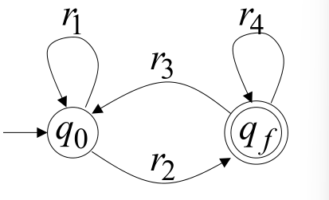
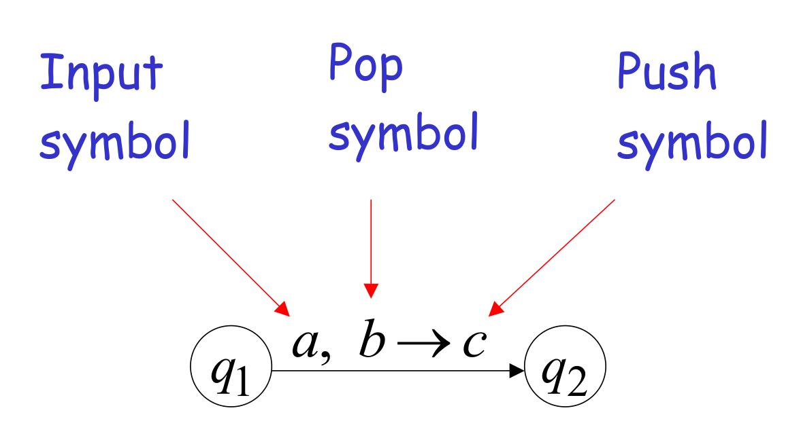
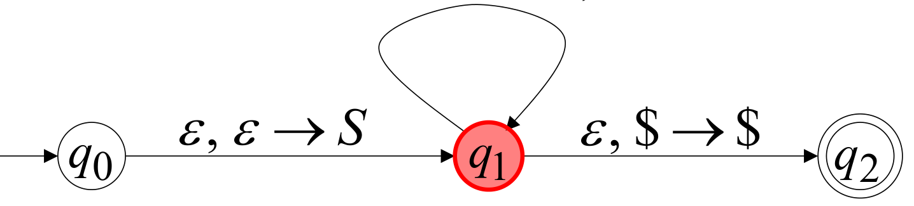
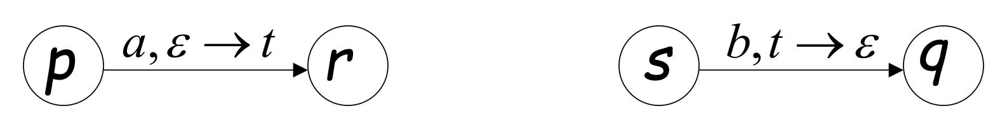
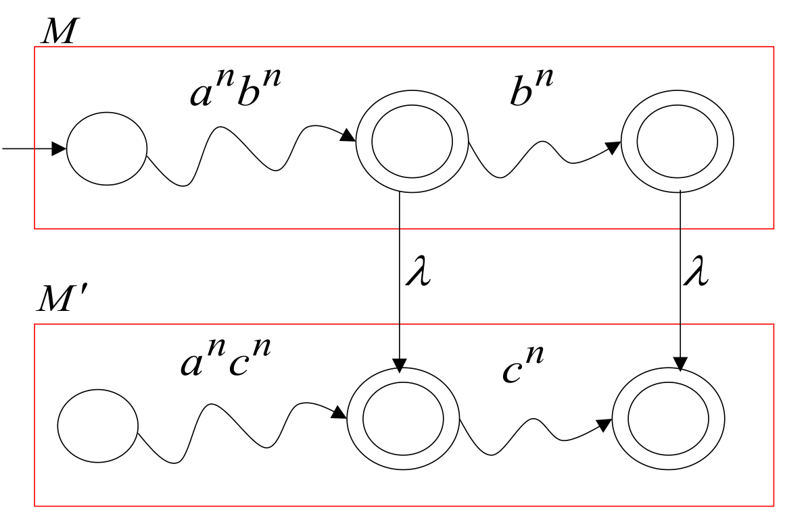
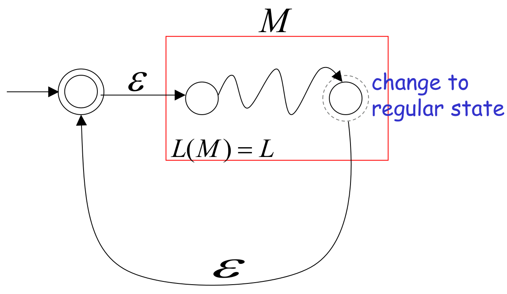
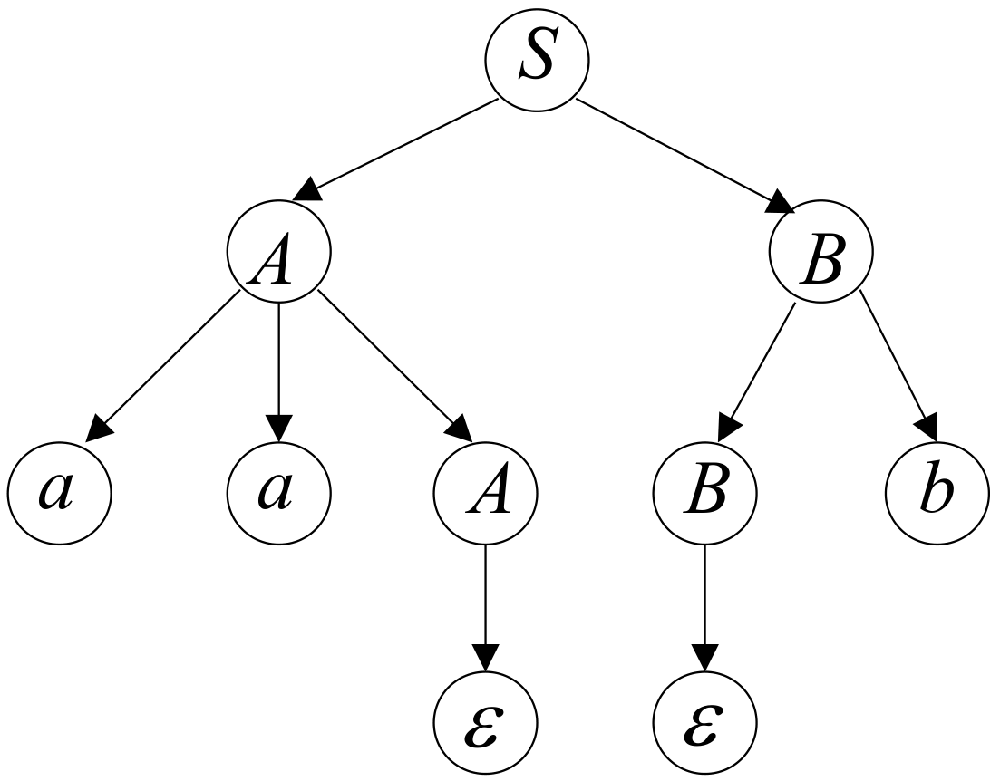
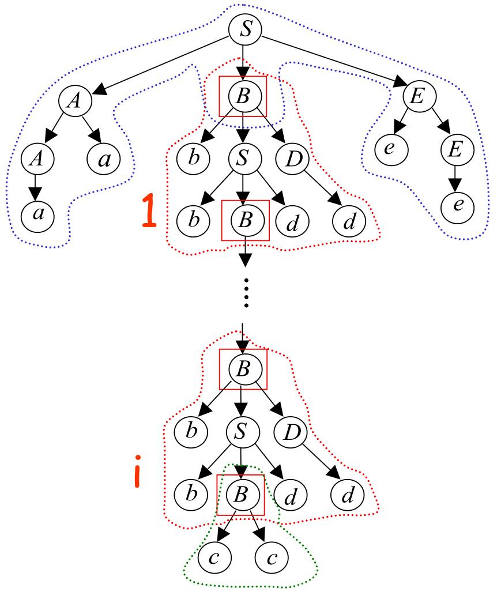
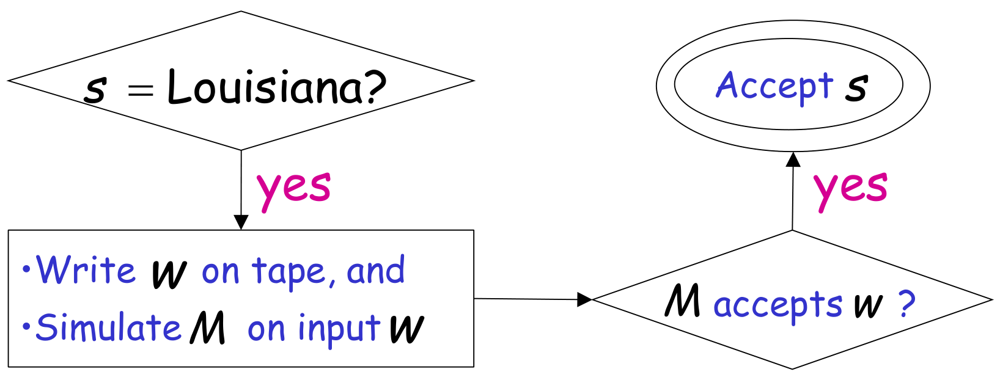
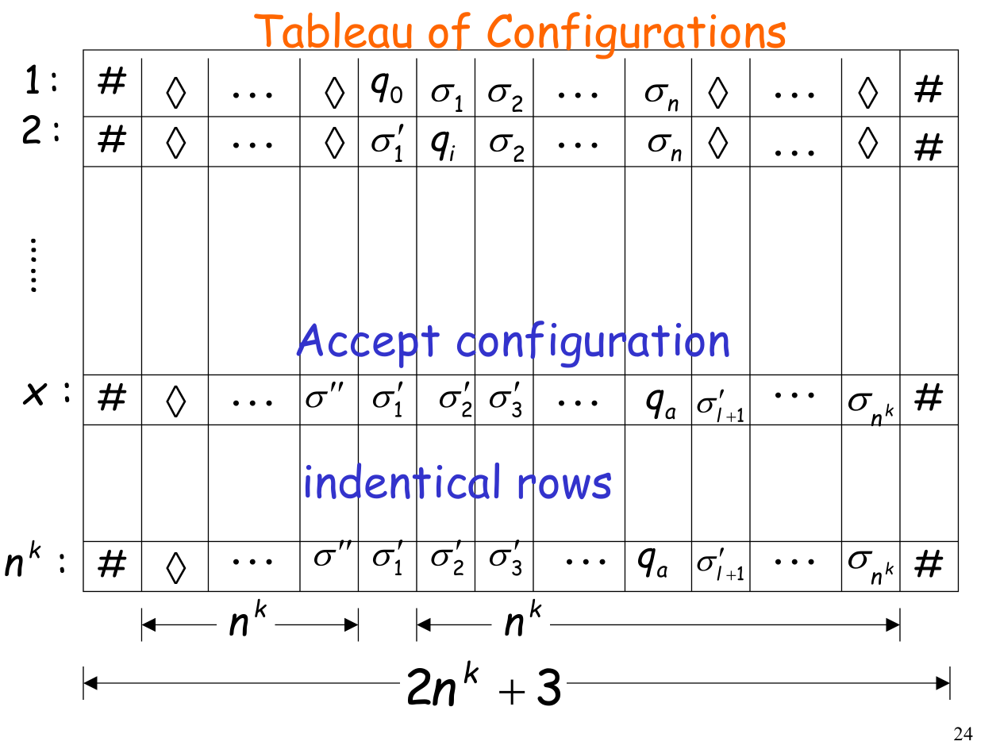

# The Theory of Computation

## Overview

| Machine | Grammar | Language |
|---------|---------|----------|
|DFA, NFA|Regular Grammar (Right-Linear Grammars&Left-Linear Grammars)|Regular Language|
|DPDA||Deterministic Context-Free Language|
||Linear Grammars|*Linear Language*|
|PDA|Context-Free Grammar|Context-Free Language|
|TM(Halt)||Turing Decidable Language|
|TM||Turing Acceptable(Recognizable) Language|
|||Non Turing-Acceptable Languages|

> Deterministic Context-Free Languages and Linear Languages are incomparable.

## Machines

### Deterministic Finite Automaton (DFA)

$$
M = (Q,\Sigma,\delta,q_0,F)
$$

$Q$: set of states
$\Sigma$: input alphabet
$\delta: Q\times \Sigma \to Q$: transition function (e.g. $\delta(q_0,x)=q_1$)
$q_0$: initial state
$F$: set of accepting states

**Extended Transition Function $\delta: Q\times \Sigma^* \to Q $**: $\delta^*(q,w)$ Describes the resulting stat0e after scanning string w from state q.

Language accepted by $M$: $L(M)=\{w\in \Sigma^*: \delta^*(q_0,w)\in F\}$

### Non-Deterministic Finite Automaton (NFA)

$$
M = (Q,\Sigma,\delta,q_0,F)
$$

$Q$: set of states
$\Sigma$: input alphabet ($\varepsilon \notin \Sigma$)
$\delta: Q\times (\Sigma\cup\{\varepsilon\}) \to P(Q)$: transition function (e.g. $\delta(q_0,x)=\{q_1, q_2,...\}$)
$q_0$: initial state
$F$: set of accepting states

- more than one choices

- no transition
- epsilon transitions

> Transition function describe resulting states reached by following **one** transition with input symbol x.
>
> For any state q, $q \in \delta^*(q,\varepsilon)$

Language accepted by $M$: $L(M)={w_1,w_2,...}$ where for each $w_m$, $\delta^*(q_0,w_m)=\{q_i,...q_k,...,q_j\}$, there is some $q_k \in F$

#### Conversion to DFA

1. initial state := $\delta^\ast(q_0,\varepsilon)$
2. for NFA state $\{q_i,...\}$: add transition $\delta(\{q_i,...\}, a) = \bigcup\limits_i \delta^\ast(q_i,a)$
3. repeat until no more state can be added
4. if $q_i$ is accepting state in DFA, set states including $q_i$ in NFA to be accepting state

Proof: by Induction on $|v|$ (the length of input string)

DFA is trivially a NFA && NFA can be converted to DFA => {Languages accepted by NFAs} = {Regular Languages(Languages accepted by DFAs)}

#### Right-linear grammar <=> NFA <=> Regular expression

##### Regular grammar => NFA

- variables as states (plus a special final state $V_F$, correspond to productions with no vars on the right side)

- productions as transitions (add intermediate nodes if multiple constants)

##### NFA => Regular grammar

- states as vars
- transitions as productions
- for any final state $q_f$, add production $q_f \to \lambda$

##### RE => NFA

Induction

Basis: $\empty$, $\{\varepsilon\}$, $\{a\}$ are regular languages (and have corresponding NFAs)

Suppose $L(r_1)$ and $L(r_2)$ are regular languages, 

- $L(r_1+r_2)=L(r_1)\cup L(r_2)$
- $L(r_1\cdot r_2)=L(r_1)L(r_2)$
- $L(r_1^*)=(L(r_1))^*$
- $L((r_1))=L(r_1)$ (trivial)

They are also regular languages.

Using the regular closure of operations, we can construct recursively the NFA.

##### NFA => RE

Removing states until only 2 states remaining

The resulting regular expression is $r = r_1^*r_2+(r_4+r_3r_1^*r_2)^*$

### Pushdown Automaton (PDA)

non-deterministic by default
$$
M=(Q,\Sigma,\Gamma,\delta,q_0,z,F)
$$

$Q$: set of states  
$\Sigma$: input alphabet  
$\Gamma$: stack alphabet(incl. \$)
$\delta$: transition function (e.g. $\delta(q_0,a,w_1)=\{(q_1,w_2)\}$)  
$q_0$: initial state  
$z$: stack start symbol  
$F$: accept states

{style="zoom:25%;"}

`b`, `c` can also be $\varepsilon$ or strings (replace multiple top symbols, can be simulated with intermediate states)

**Instantaneous Description**:
$$
(q,u,s)
$$
current state, remaining input, current stack contents

e.g. $(q_0,aaabbb,\$)\succ(q_1,aabbb,a\$)$

Language accepted by PDA: $L(M)=\{w: (q_0,w,z)\overset*\succ (q_f,\varepsilon,s)\}$

#### CFG <=> PDA

##### CFG => PDA

For each production $A\to w$ in G, add transition q1->q1: $\varepsilon , A\to w$
For each terminal $a$, add: $a, a\to \varepsilon$

##### PDA => CFG

VERY COMPLICATED; prove by induction

>1. Modify PDA: 
>
>   1. single accept state; 
>   2. new initial stack symbol; 
>   3. empty the stack before new acceptance; 
>   4. each transition pops or pushes only
>
>2. The grammar starts with $A_{q_0q_f}$, and has productions:
>
>   1. $A_{qq}\to \varepsilon$
>
>   2. $A_{pq}\to A_{pr}A_{rq}$
>
>   3. $A_{pq}\to aA_{rs}b$ for every pairs of transition:
>
>      

### Deterministic PDA (DPDA)

- Non-deterministic choices not allowed

- Partial transition allowed
- $\varepsilon$-transitions allowed if no other choices

#### PDAs have more power than DPDAs

Every DPDA is also a PDA.

There exists a CFG not accepted by DPDA: $L=\{a^nb^n\}\cup\{a^nb^{2n}\}$

If it can be accepted by a DPDA, be can construct a DPA that accepts $L\cup\{a^nb^nc^n\}$, which contradicts the pumping lemma.

{style="zoom:33%;"}

### Turing Machine

Turing Machines are deterministic:

- Partial transition allowed
- $\varepsilon$-transitions not allowed

A string is accepted if machine halts in an **accept state**.

A string is rejected if machine halts in a **non-accept state** or if machine enters an **infinite loop**
$$
M=(Q, \Sigma, \Gamma, \delta, q_0, \diamondsuit, F)
$$

$\Gamma$: tape alphabet(incl. $\diamondsuit$)
$\delta$: transition function, e.g. $\delta(q_1,a)=(q_2,b,R)$
$\diamondsuit$: blank

**Instantaneous Description** (Configuration):
$$
q_0aabb \succ bq_1abb
$$
$$
L(M)=\{w:q_0\overset*\succ x_1q_fx_2\}
$$

If a language is accepted by a TM, it is:
Turing Recognizable/Turing Acceptable/Recursively Enumerable

#### Variations

they all have the same power (accept Turing Recognizable languages)

- Stay-Option
- Semi-Infinite Tape
  - ->STM: Use multiple track tape to simulate Standard TM

- Multitape
  - STM->: multi-track tape, pair each tape with a head position tape

- Multidimensional
  - STM->: 2-track tape for symbol and coordinates

- Nondeterministic
  - 2-dimensional->: For each configuration in current step of non-deterministic machine,
    if there are two or more choices: 1. Replicate configuration 2.Change the state in the replicas

#### Universal Turing Machine

A specific Turing machine that can **simulate any arbitrary Turing machine** $M$ on any arbitrary input $w$, overcoming the "Hardwired" Limitation of standard Turing machines.

Input: <M,w>, description and input of M

Tapes: (Multi-tape Turing Machine has the same computational power as a Standard Turing Machine)

1. Description of M (Binary encoded)
2. Tape contents of M
3. State of M

#### Enumerator

An enumerator for a set of strings $S$ is a TM that generates all the strings of $S$ one by one, and each string is generated in finite time.

TM can be binary encoded:

- Symbols: $a$ -> `1`, $b$ -> `11`, ...
- States: $q_1$ -> `1`, $q_2$ -> `11`, ...
- Move: L -> `1`, R -> `11`

use `0` and `00` as separators

##### Enumerator for TM

Repeat:

1. Generate the next binary string
2. If describes a TM, print string on tape; else ignore string

#### Languages not accepted by TM

Turing machines are **countable**.

The set of languages is the power set of $\Sigma^*$, **uncountable**.

There are simply more languages than TMs.

##### Non Turing-Acceptable language $\bar L$

$\bar L$ consists of the 0s in the diagonal, Non Turing-Acceptable

$L$ consists of the 1s in the diagonal, Turing-Acceptable but undecidable

> L is Turing-Acceptable because we can construct a TM that for input $a^i$:
>
> 1. Enumerate the i-th TM
> 2. Run it on input
>
> We can't do that for $\bar L$ because on step 2 we'll have to get the complement, but Turing-Acceptable Language is not closed under that.

## Languages

**Language $L$**: a set of strings

**String**: a sequence of symbols from some alphabet

**Alphabet $\Sigma$**: a set of symbols

### Operations

- set operations: $\cup \ \cap \ -$
- complement: $\bar L = \Sigma^*-L$
- reverse: $L^R=\{w^R: w\in L\}$
- concatenation: $L_1 L_2 = \{xy:x\in L_1,y\in L_2\}$
- exponent: $L^n = \underbrace{LL...L}_n$
- star-closure: $L^*=L^0\cup L^1\cup L^2\cup...$
- positive closure: $L^*=L^1\cup L^2\cup...$

### Regular Languages

A language $L$ is regular if there is a DFA $M$ that accepts it ($L(M)=L$)

The languages accepted by all DFAs form the family of regular languages.

**Closed under**: 

- union ($L_1 \cup L_2$)
- concatenation ($L_1L_2$)
- star ($L^*$)
  - {style="zoom:25%;"}
- reversal ($L^R$)
  - reverse transitions in NFA and swap initial and accept state
- complement ($\bar L$)
  - swap accept/regular states
- intersection($L_1\cap L_2$) 
  - DeMorgan's Law: $L_1\cap L_2 = \overline{\overline{L_1}\cup\overline {L_2}}$
  - OR construct a DFA M from DFAs M1, M2

#### Regular expressions

Primitive regular expressions：$\empty$（empty language）, $\varepsilon$(empty string), $\alpha$(one symbol)

Given regular expressions $r_1$ and $r_2$, 

| r | L(r) |
|-|-|
| $r_1+r_2$ | $L(r_1)\cup L(r_2)$ |
| $r_1\cdot r_2$ | $L(r_1)L(r_2)$ |
| $r_1^*$ | $(L(r_1))^*$ |
| $(r_1)$ | $L(r_1)$ |

are REs

To prove {Languages Generated by REs} = {Regular Languages}, see *NFA <=> RE*

### Context-Free Language

A language $L$ is context-free if there is a context-free grammar $G$ with $L=L(G)$

**Closed under**: union ($L_1 \cup L_2$), concatenation ($L_1L_2$), star ($L^*$), reversal ($L^R$)

#### CFG $\cap$ regular

Intersection of a **CFG** and a **regular language** is **CFG**.

Prove by constructing a NPDA out of the PDA and DFA of the 2 languages.

### Decidable Language

A language $L$ is **decidable** if there is a Turing machine (decider) $M$ which accepts and halts on every input string

aka. recursive languages

closed under complement

Undecidable Language: There is no TM which accepts L and halts on every input string.

## Grammars

$$
G=(V,T,S,P)
$$

$V$: Set of variables  
$T$: Set of terminal symbols  
$S$: Start variable  
$P$: Set of productions (in the for of $A\to S$, variable -> string of variables and terminals)
$$
L(G)=\{w:S\overset * {\Rightarrow} w, w\in T^*\}
$$

### Linear Grammars

Grammars with at most one variable at the right side of a production

### Regular Grammars

Any right-linear grammar:
$$
A \to xB \quad or \quad A \to x
$$
or left-linear grammar:
$$
A \to Bx \quad or \quad A \to x
$$

x can be empty string

#### Left-linear grammar => right-linear grammar

For every production in left-linear grammar $G$: $A \to Bv$,

add corresponding production to $G'$: $A \to v^RB$.

$L(G)=L(G')^R$ (just reverse the NFA of $L(G')$)

### Context-Free Grammar

#### Derivation

Derivation: e.g. S => AB => aaAB => aaABb => aaBb => aab

**Leftmost/Rightmost Derivation**: substitute the leftmost/rightmost variable

Derivation Tree (parse tree)

{style="zoom:33%;"}

Derivation order doesn’t matter as they give the same derivation tree.

#### Ambiguity

A CFG $G$ is ambiguous if there is a string $w\in L(G)$ which has 2 different derivation trees/leftmost derivations. 
$$
\begin{aligned}
E &\to E + E \\
E &\to E * E \\
E &\to (E) \\
E &\to a
\end{aligned}
\quad\Rightarrow\quad
\begin{aligned}
E &\to E + T \mid T \\
T &\to T * F \mid F \\
F &\to (E) \mid a
\end{aligned}
$$

#### Simplification

Use *Substitution Rule* to

- Remove nullable variables (eliminate $\varepsilon$-production ($A \to \varepsilon$), except for the start variable)
- Remove unit-productions ($A \to B$, single var on both sides)

then

- Remove useless variables (vars that cannot derive any string of terminals or unreachable)

#### Normal Forms

##### Chomsky Normal Form

$$
A \to BC \quad {or}\quad A \to a
$$

Doesn't generate $\varepsilon$.

conversion:

- Remove nullable & unit productions
- Introduce new vars for terminals $T_a,T_b,T_c$
- Introduce intermediate var to break productions yielding more than 1 vars $V_1, V_2,...$

##### Greinbach Normal Form:

$$
A \to aV_1V_2...V_k \qquad k\ge 0
$$

Good for parsing strings.

It is difficult to find the Greinbach normal of a grammar. (terminal has to be on the left)

## Pumping

### Pumping Lemma for Regular Languages

Given an infinite regular language $L$, there exists an integer $p$, for any string $w \in L$ with length $|w| \ge p$, we can write

$$
w = xyz, \quad |xy| \leq p, \quad |y| \ge 1
$$

such that:
$$
xy^iz \in L, \forall i \geq 0
$$

$p$: critical length

Pumping lemma also holds for finite language. Just set p = M+1, where M denotes the max length of strings in L.

### Pumping Lemma for Context-Free Languages

For any infinite context-free language $L$, there exists an integer $p$ such that for any string $w \in L$ with length $|w| \ge p$, we can write
$$
w = uvxyz, \quad |vxy| \leq p, \quad |vy| \ge 1
$$
such that:
$$
uv^ixy^iz \in L, \forall i \geq 0
$$

$p$: magic number

{style="zoom:50%;"}

Max string length without a repeated state from root to leaf: $t^r$
r: number of variables
t: max right-hand size of any production

## Decidability

*If*: Language A is reduced to B and language B is decidable 
*Then*: A is decidable

*If*: Language A is reduced to B and language B is undecidable 
*Then*: B is undecidable

### Decidable Problems

- EMPTY_DFA
  - Determine whether there is a path from the initial state to any accepting state
- FINITE_DFA
  - Check if there is a walk with a cycle from the initial state to an accepting state
- A_DFA
  - Run DFA on the input string
- EQUAL_DFA
  - $L(M)=(L_1\cap \overline{L_2})\cup(\overline{L_1}\cap L_2)$ EMPTY?

### Undecidable Problems

- **Membership Problem**
  - if decidable, then every Turing acceptable language is also decidable. But there is a Turing-Acceptable language which is undecidable ($L$)

- **Halting Problem**
  - $A_{TM}$ reduction
  - alt: construct a contradictory machine F(diagonalization)

- State-entry problem
- Blank-tape halting problem
- Empty language problem
  - 
  - also works for regular language/size 2 language/...

## Time Complexity

- $\text{TIME}(T(n))$: All languages decidable by a deterministic TM in time $\mathcal O(T(n))$
- $\text{NTIME}(T(n))$: All languages decidable by a non-deterministic TM in time $\mathcal O(T(n))$

Polynomial time: $P=\bigcup\limits_k \text{TIME}(n^k)$

Non-Deterministic Polynomial time: $NP=\bigcup\limits_k \text{NTIME}(n^k)$

### P problems

- CYK-algorithm: solve CFL membership problem in $\text{TIME}(n^3)$. Bottom-up Dynamic Programming with CNF
- 2-SAT: Construct a Graph and reduce to path search
  - vertex for each var and negation;
  - add edge (a,b) if there exists a clause equivalent to $(\neg a\lor b)$ (if a is true then downstream vars also have to be true)
  - satisfiable if no path: x->!x

### Polynomial Time Reductions

**Polynomial Computable Function $f$**: A deterministic TM computes $f(w)$ in $\mathcal O({|w|}^k)$ for any $w$.

Language A is *polynomial time reducible* to B ($ A \le_p B$) if there is a computable function $f$ such that:
$$
w \in A \iff f(w) \in B
$$

- $B \in P \Rightarrow A \in P$
- $A$ is NP-complete && B in NP => B is NP-complete

### NP-Complete

A Language L is NP-complete if:

* L is in NP, and
* Every language in NP is reduced to L in polynomial time

| Example                                         | Proof                  |
| ----------------------------------------------- | ---------------------- |
| **SAT**                                         | **Cook-Levin Theorem** |
| 3CNF-SAT                                        | SAT                    |
| Clique problem                                  | 3CNF-SAT               |
| Vertex-Cover (every edge touches one node in S) | 3CNF-SAT               |
| Hamiltonian-Path (visit each node once)         | 3CNF-SAT               |
| MAX2SAT                                         | 3CNF-SAT               |
| Dominating Set Problem                          | Vertex-Cover           |
| ---                                             |                        |
| Set Cover                                       | 3CNT-SAT               |
| Subset Sum                                      | 3CNT-SAT               |
| Partition                                       | Subset Sum             |
| Knapsack                                        | Subset Sum             |
| Bin Packing                                     | Partition              |
| Steiner Tree                                    | ??                     |
| Coloring                                        | ??                     |

>Max2SAT
>Gadgets: 
>$$
>\psi(x,y,z,w) = (x)\land(y)\land(z)\land(w)\\\land(\neg x \lor\neg y)\land(\neg y\lor\neg z)\land(\neg z \lor\neg x)\\\land(x\lor \neg w)\land(y\lor \neg w)\land(z\lor\neg  w)
>$$
>Every satisfying assignment for $(x\lor y\lor z)$ can be extended into an assignment that satisfies exactly 7 of the clauses. Other assignments can satisfy at most 6 of the clauses.

#### Proof of Cook-Levin Theorem

Take an arbitrary language L in NP, 
Let M be the NTM that decides L in polyn. time

The computation of M on an input string w ($|w|=n$) can be visualized as a **tableau** of size $(2n^k+3)\cdot n^k$

{style="zoom:50%;"}

Tableau alphabet: $C=\{\#\}\cup\{\text{tape alphabet}\}\cup\{\text{states}\}$
Constant size (O(1))

Define var $x_{i,j,s}$ such that if position i,j contains symbol x `=1` else `=0`
$$
\varphi(M,w)=\varphi_{cell}\land\varphi_{start}\land\varphi_{accept}\land\varphi_{move}
$$

When the formula is satisfied, it describes an accepting computation in the tableau of M on input w.

$\varphi_{cell}$: every cell in the tableau contains exactly one symbol $O(n^{2k})$
$$
\varphi_{cell}=\underset{\text{all}\ i,j}{\land}[(\underset{s\in C}\lor x_{i,j,s})\land(\underset{s,t\in C\ s\neq t}\land (\overline{x_{i,j,s}}\lor\overline{x_{i,j,t}}))]
$$
$\varphi_{start}$: tableau starts with the initial configuration $O(n^k)$

$\varphi_{accept}$: computation leads to acceptance $O(n^{2k})$
$$
\varphi_{accept}=\underset{\begin{gather}\text{all}\ i,j\\\text{all}\ q\in F \end{gather}}\lor x_{i,j,q}
$$
$\varphi_{move}$: sequence is valid (2x6 legal windows) $O(n^{2k})$
number of possible legal windows: $|C|^6$, possible cells: $(2n^k+3)n^k$

We have that
$$
w\in L \iff \varphi(M,w)\in SAT
$$
Constructed in $O(n^{2k})$

L is polynomial-time reducible to SAT

